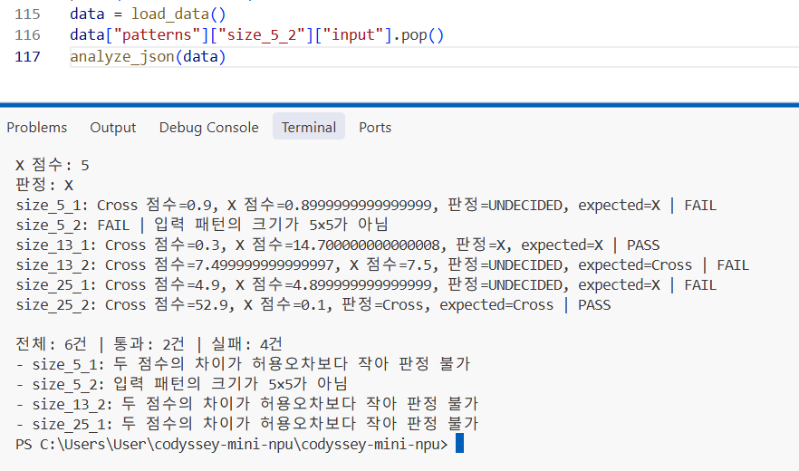
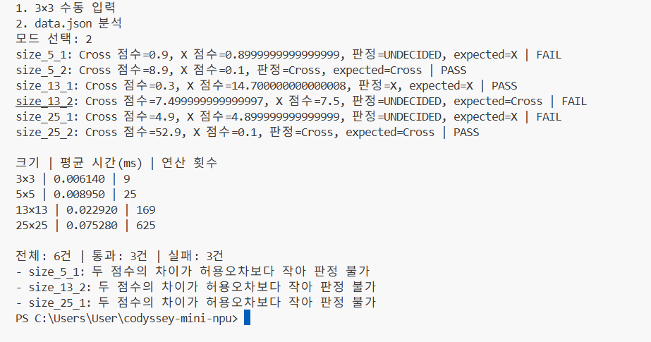

# Mini NPU 시뮬레이터 · 미션 1-3

입력 패턴을 두 필터와 각각 비교해 어느 쪽에 더 가까운지 판정하는 Python 프로그램입니다. MAC(Multiply-Accumulate, 곱셈-누산)은 입력과 필터에서 같은 위치의 숫자를 곱한 뒤 그 결과를 차례로 더하는 계산입니다.

## 실행 방법

1. `main.py`와 `data.json`이 있는 폴더에서 터미널을 엽니다.
2. `python main.py`를 실행합니다.
3. `1`을 선택하면 3×3 수동 입력, `2`를 선택하면 `data.json` 분석을 실행합니다.

## 구현 내용

- 수동 입력 모드는 필터 A, 필터 B, 입력 패턴을 차례로 받습니다. 한 행에 숫자 세 개를 공백으로 구분해 입력합니다. 숫자가 세 개가 아니거나 숫자로 바꿀 수 없는 값이 있으면 같은 행을 다시 입력합니다.
- 파일 분석 모드는 각 패턴과 같은 크기의 필터를 찾아 점수를 계산합니다. 정답의 `+`와 `x`는 `Cross`와 `X`로 바꿔 판정과 비교합니다.
- 두 점수 차이의 절댓값이 `1e-9`보다 작으면 `UNDECIDED`(판정 불가)로 처리합니다.
- `data.json`의 경로는 `main.py`가 있는 폴더를 기준으로 찾습니다.

## 결과 리포트

1. 3×3 수동 입력 예시에서는 A가 1.0점, B가 5.0점으로 B가 선택됐습니다.
2. 원본 `data.json`의 6개 케이스는 3개 통과, 3개 실패였습니다.
3. `size_5_1`은 두 점수가 모두 약 0.9여서 판정 불가였고, 기대값 `X`와 일치하지 않았습니다.
4. `size_13_2`는 두 점수가 모두 약 7.5여서 판정 불가였고, 기대값 `Cross`와 일치하지 않았습니다.
5. `size_25_1`은 두 점수가 모두 약 4.9여서 판정 불가였고, 기대값 `X`와 일치하지 않았습니다.
6. 소수는 컴퓨터에서 근삿값으로 저장될 수 있습니다. 위 세 케이스의 미세한 점수 차이는 허용오차 안에 있었습니다.
7. `size_5_2`의 마지막 행을 임시로 제거하자 해당 케이스는 크기 오류로 처리됐습니다. 뒤의 케이스들도 실행됐고, 요약은 통과 2개, 실패 4개였습니다.
8. 아래 성능표는 크기별로 MAC을 10회 실행해 1회당 평균을 밀리초로 계산한 결과입니다. 키보드 입력과 화면 출력은 측정 구간 밖에서 처리했습니다.
9. 한 변의 길이가 N이면 배열에 N²개의 칸이 있습니다. 점수 하나를 구할 때 각 칸을 한 번씩 처리하므로 시간 복잡도는 O(N²)입니다.
10. 같은 패턴을 필터 두 개와 비교하면 점수를 두 번 계산합니다. 표의 연산 횟수는 필터 하나를 기준으로 한 값입니다.

| 배열 크기 | 평균 시간(ms) | MAC 연산 횟수 |
|---|---:|---:|
| 3×3 | 0.006140 | 9 |
| 5×5 | 0.008950 | 25 |
| 13×13 | 0.022920 | 169 |
| 25×25 | 0.075280 | 625 |
## 1000×1000 입력의 시간과 메모리

한 변의 길이가 1000이면 패턴 한 장에 1,000,000개의 원소가 있다.
필터 하나와 비교할 때 1,000,000회의 MAC(곱셈-누산)이 필요하고,
필터 두 개와 비교하면 2,000,000회가 필요하다.

25×25에서는 필터 하나당 625회이므로, 1000×1000에서는 연산 횟수가
1,600배로 늘어난다. 이는 연산 횟수의 비율이다. 실제 실행 시간은
메모리 접근 비용과 실행 환경에도 영향을 받는다. 이 프로젝트에서는
25×25까지 측정했으며 1000×1000 수치는 이론상 추정이다.

패턴 하나와 필터 두 개를 각각 원소당 8바이트인 연속 배열로 저장한다고
가정하면, 숫자 데이터에만 약 24 MB가 필요하다
(3 × 1,000,000 × 8바이트). 현재 Python의 중첩 리스트는 리스트와
원소 참조 등에도 공간을 쓰므로 실제 메모리 사용량은 이 추정과 다르다.

우선 각 행을 순서대로 이어 붙여 연속된 1차원 배열로 저장하고, 인접한
원소를 순서대로 읽는 방식으로 바꿔 볼 수 있다. 같은 입력을 반복해서
비교할 때는 배열을 한 번만 변환해 재사용한다. 비교할 필터가 많아지면
입력을 작은 블록으로 나누고, 읽어 온 블록을 여러 필터 계산에 재사용하는
타일링을 고려할 수 있다. 병렬화는 작업 분배와 부분합을 합치는 비용까지
포함해 효과를 비교한다.

## CPU와 NPU의 병목 비교

현재 프로그램은 CPU(Central Processing Unit, 중앙 처리 장치)에서
Python 이중 반복문으로 원소를 하나씩 읽어 계산한다. 이 구현에서는
반복문 실행과 리스트 접근에도 시간이 든다. 입력이 커지면 데이터를
메모리에서 읽는 비용의 비중도 커질 수 있다. 연속 배열과 벡터화 연산을
사용하면 여러 원소를 묶어서 처리할 수 있다.

NPU(Neural Processing Unit, 신경망 처리 장치)는 곱셈-누산을 여러
연산 장치에서 병렬로 수행하도록 설계된다. 연산 장치에 데이터를 공급하는
속도가 느리면 메모리 대역폭이 처리량을 제한한다. 반대로 데이터를 충분히
빠르게 공급할 수 있다면 연산 장치가 단위 시간에 처리할 수 있는 연산량이
한계가 된다. 작은 입력에서는 데이터를 장치로 옮기고 연산을 시작하는
비용 때문에 병렬 처리의 이점이 작을 수 있다.

이 프로젝트에서 측정한 값은 Python 코드의 CPU 실행 시간이다.
NPU의 실행 시간은 측정하지 않았으며, 위 내용은 처리 방식에 따른
병목의 차이를 설명한 것이다.
## 실행 화면

### 3×3 수동 입력과 판정

### 잘못된 입력 후 재입력

### 배열 크기 오류 처리

### 크기별 성능 측정과 결과 요약
