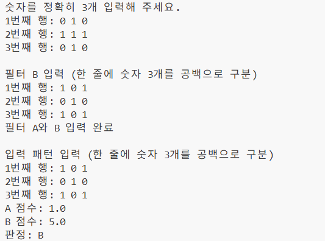
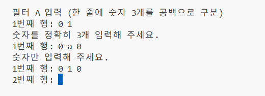

# Mini NPU 시뮬레이터 · 미션 1-3

입력 패턴을 두 필터와 각각 비교해 어느 쪽에 더 가까운지 판정하는 Python 프로그램입니다. MAC(Multiply-Accumulate, 곱셈-누산)은 입력과 필터에서 같은 위치의 숫자를 곱한 뒤 그 결과를 차례로 더하는 계산입니다.

## 실행 방법

1. `main.py`와 `data.json`이 있는 폴더에서 터미널을 엽니다.
2. `python main.py`를 실행합니다.
3. `1`을 선택하면 3×3 수동 입력, `2`를 선택하면 `data.json` 분석을 실행합니다.

반복 횟수 기본값은 두 모드 모두 10회입니다. 예를 들어 `python main.py --repeats 30`으로 실행하면 시간 측정만 30회 반복합니다.

## 구현 내용

- 수동 입력 모드는 필터 A, 필터 B, 입력 패턴을 차례로 받습니다. 한 행에 숫자 세 개를 공백으로 구분해 입력합니다. 숫자가 세 개가 아니거나 숫자로 바꿀 수 없는 값이 있으면 같은 행을 다시 입력합니다.
- 파일 분석 모드는 각 패턴과 같은 크기의 필터를 찾아 점수를 계산합니다. 정답의 `+`와 `x`는 `Cross`와 `X`로 바꿔 판정과 비교합니다.
- 두 점수 차이의 절댓값이 `1e-9`보다 작으면 `UNDECIDED`(판정 불가)로 처리합니다.
- `data.json`의 경로는 `main.py`가 있는 폴더를 기준으로 찾습니다.

### 입력, 필터 조회와 점수 해석

- 수동 모드는 입력 패턴을 고정한 채 A와 B의 연산 시간을 각각 측정합니다. 콘솔에 `10회 평균 시간(ms)` 열이 표시되며, 필터당 9회의 MAC 연산을 수행합니다.
- 수동 입력 오류가 나면 같은 행을 다시 묻고 올바른 형식도 함께 보여 줍니다. 예: `숫자를 정확히 3개 입력해 주세요. 예: 1.0 0.0 1.0`.
- 파일 분석 모드는 `size_N_idx` 형식에서 크기를 읽고 `filters`의 동일 크기 필터 묶음을 찾습니다. 기본 보고 크기는 5·13·25이며, 이름 규칙을 지키고 대응 필터가 있는 다른 크기도 분석할 수 있습니다.
- 필요한 필터 묶음이나 Cross/X 필터가 없거나, 라벨·배열 크기·숫자 값이 유효하지 않으면 해당 케이스의 실패 사유를 출력하고 다음 케이스를 처리합니다. 파일을 열거나 해석할 수 없으면 읽기 오류를 표시합니다.
- 점수는 정규화하지 않은 곱셈의 누적 합입니다. 필터 값의 크기나 배열 크기가 달라지면 점수의 범위도 달라질 수 있습니다. 현재 점수는 같은 입력에 대한 후보 필터 비교에 사용합니다. 서로 다른 입력 간 비교가 필요하다면 벡터 길이로 나눈 코사인 유사도 등을 별도로 검토할 수 있습니다.

### 모드 1과 모드 2의 동점 처리

두 모드 모두 `classify()`를 사용합니다. 두 점수의 절대 차이가 `EPSILON = 1e-9`보다 작으면 `UNDECIDED`를 반환합니다. 이 기준은 소수 누산의 미세한 오차를 동점으로 처리하기 위해 사용합니다. 예를 들어 원본 `size_5_1`의 0.9와 0.8999999999999999 사이의 차이는 이 기준보다 작습니다.

| 모드 | 동점 화면 표시 | 결과 집계 |
|---|---|---|
| 1. 3×3 수동 입력 | `판정: 판정 불가` | 정답 라벨 비교나 통과·실패 집계 없음 |
| 2. 파일 분석 | `판정=UNDECIDED` | 기대 라벨은 `Cross` 또는 `X`이므로 실패에 포함. 판정 불가 건수도 따로 표시 |

파일 분석의 동점 로그에는 두 점수, 절대 차이와 허용오차를 남깁니다. 통과율은 통과 건수를 전체 건수로 나눈 값이며, 케이스가 0건이면 `해당 없음`으로 표시합니다.

### 라벨 정규화 함수를 분리한 이유

`normalize_label()`은 문자열의 앞뒤 공백을 제거하고 소문자로 바꾼 후 `LABEL_ALIASES`에서 표준 이름을 찾습니다. 반환값은 `Cross`, `X` 또는 `None`입니다. `None`은 미등록 표기나 문자열이 아닌 값에 반환되며, 파일 분석 시 해당 케이스의 라벨 오류로 처리합니다.

필터 이름과 기대 라벨에 같은 함수를 재사용하므로 규칙을 한 곳에서 수정할 수 있습니다. 또한 점수 계산을 실행하지 않고 라벨 변환만 따로 검증할 수 있습니다.

### 새 라벨 추가와 검증 절차

1. 기존 분류에 별칭을 추가하려면 `LABEL_ALIASES`에 변환 규칙을 등록합니다. 예를 들어 `plus`를 `Cross`에 연결할 수 있습니다.
2. 별칭을 추가해도 기존 두 필터의 점수 비교 규칙을 사용합니다. 세 번째 분류를 추가하려면 표준 라벨과 필터를 등록하고, 모든 후보 점수를 비교하는 판정 규칙과 결과 표시도 함께 확장합니다. 최고점과 차점이 허용오차 안에서 동점이면 `UNDECIDED`로 처리합니다.
3. 별칭 등록 후 테스트용 데이터 사본의 기존 Cross 통과 케이스에서 `expected`를 `"plus"`로 바꿔 `expected=Cross`와 `PASS`가 나오는지 확인합니다. 필터 이름의 별칭은 기존 Cross 키를 `plus`로 교체해 확인합니다. 기존 `+`, `cross`, `x`도 다시 확인합니다.

별칭 등록 후 테스트 케이스 예시: `size_5_2`의 기존 `input` 유지 → `"expected": "plus"` → `expected=Cross | PASS`.

## 결과 리포트

1. 3×3 수동 입력 예시에서는 A가 1.0점, B가 5.0점으로 B가 선택됐습니다.
2. 원본 `data.json`의 6개 케이스는 3개 통과, 3개 실패였습니다.
3. `size_5_1`은 두 점수가 모두 약 0.9여서 판정 불가였고, 기대값 `X`와 일치하지 않았습니다.
4. `size_13_2`는 두 점수가 모두 약 7.5여서 판정 불가였고, 기대값 `Cross`와 일치하지 않았습니다.
5. `size_25_1`은 두 점수가 모두 약 4.9여서 판정 불가였고, 기대값 `X`와 일치하지 않았습니다.
6. 소수는 컴퓨터에서 근삿값으로 저장될 수 있습니다. 위 세 케이스의 미세한 점수 차이는 허용오차 안에 있었습니다.
7. `size_5_2`의 마지막 행을 임시로 제거하자 해당 케이스는 크기 오류로 처리됐습니다. 뒤의 케이스들도 실행됐고, 요약은 통과 2개, 실패 4개였습니다.
8. 아래 성능표는 크기별로 MAC을 10회 실행해 1회당 평균을 밀리초로 계산한 결과입니다. 키보드 입력과 화면 출력은 측정 구간 밖에서 처리했습니다.
9. 한 변의 길이가 N이면 배열에 N²개의 칸이 있습니다. 점수 하나를 구할 때 각 칸을 한 번씩 처리하므로 시간 복잡도는 O(N²)입니다.
10. 같은 패턴을 필터 두 개와 비교하면 점수를 두 번 계산합니다. 표의 연산 횟수는 필터 하나를 기준으로 한 값입니다.

다음 시간은 기존 캡처에 기록된 크기별 **필터 1개, 10회 반복 평균**입니다.

| 배열 크기 | 10회 평균 시간(ms) | MAC(필터 1개) | MAC(필터 2개 판정) |
|---|---:|---:|---:|
| 3×3 | 0.006140 | 9 | 18 |
| 5×5 | 0.008950 | 25 | 50 |
| 13×13 | 0.022920 | 169 | 338 |
| 25×25 | 0.075280 | 625 | 1250 |

### 판정 불가 케이스 상세

| 케이스 | Cross 점수 | X 점수 | 필터 묶음 | 한 건 판정의 MAC 횟수 |
|---|---:|---:|---|---:|
| `size_5_1` | 0.9 | 0.8999999999999999 | `filters.size_5` | 50 |
| `size_13_2` | 7.499999999999997 | 7.5 | `filters.size_13` | 338 |
| `size_25_1` | 4.9 | 4.899999999999999 | `filters.size_25` | 1250 |

입력 배열은 [data.json](data.json)의 `patterns.<케이스 이름>.input`에 있습니다. 세 케이스 모두 두 필터를 계산하므로 연산 횟수는 `2 × N²`이고 시간 복잡도는 O(N²)입니다. 위 성능표의 시간은 크기별 표본에서 측정한 값입니다. 다음 표에는 보완 작업에서 별도로 측정한 **두 필터 점수 계산의 합계 시간**을 기록했습니다. Python 3.13.9에서 원본 데이터를 사용해 케이스별로 10회 반복한 평균입니다. 분류, 입력과 출력은 측정 구간에서 제외했습니다.

| 케이스 | 두 필터 평균 시간(ms) | 한 건 판정의 MAC 횟수 |
|---|---:|---:|
| `size_5_1` | 0.005500 | 50 |
| `size_13_2` | 0.023860 | 338 |
| `size_25_1` | 0.080630 | 1250 |

## 1000×1000 입력의 시간과 메모리

한 변의 길이가 1000이면 패턴 한 장에 1,000,000개의 원소가 있다.
필터 하나와 비교할 때 1,000,000회의 MAC(곱셈-누산)이 필요하고,
필터 두 개와 비교하면 2,000,000회가 필요하다.

25×25에서는 필터 하나당 625회이므로, 1000×1000에서는 연산 횟수가
1,600배로 늘어난다. 이는 연산 횟수의 비율이다. 실제 실행 시간은
메모리 접근 비용과 실행 환경에도 영향을 받는다. 이 프로젝트에서는
25×25까지 측정했으며 1000×1000 수치는 이론상 추정이다.

패턴 하나와 필터 두 개를 각각 원소당 8바이트인 연속 배열로 저장한다고
가정하면, 숫자 데이터에만 약 24 MB가 필요하다
(3 × 1,000,000 × 8바이트). 현재 Python의 중첩 리스트는 리스트와
원소 참조 등에도 공간을 쓰므로 실제 메모리 사용량은 이 추정과 다르다.

우선 각 행을 순서대로 이어 붙여 연속된 1차원 배열로 저장하고, 인접한
원소를 순서대로 읽는 방식으로 바꿔 볼 수 있다. 같은 입력을 반복해서
비교할 때는 배열을 한 번만 변환해 재사용한다. 비교할 필터가 많아지면
입력을 작은 블록으로 나누고, 읽어 온 블록을 여러 필터 계산에 재사용하는
타일링을 고려할 수 있다. 병렬화는 작업 분배와 부분합을 합치는 비용까지
포함해 효과를 비교한다.

Python 중첩 리스트를 비교할 때는 `sys.getsizeof()`로 바깥 리스트, 각 행 리스트, 고유한 숫자 객체의 크기를 각각 합산할 수 있습니다. 같은 객체를 여러 칸에서 참조하면 한 번만 셉니다. 연속 배열의 데이터 크기는 `len(buffer) × buffer.itemsize`로 구합니다. 배열 변환 중의 최고 메모리 사용량은 `tracemalloc`으로 별도로 비교할 수 있습니다.

## CPU와 NPU의 병목 비교

현재 프로그램은 CPU(Central Processing Unit, 중앙 처리 장치)에서
Python 이중 반복문으로 원소를 하나씩 읽어 계산한다. 이 구현에서는
반복문 실행과 리스트 접근에도 시간이 든다. 입력이 커지면 데이터를
메모리에서 읽는 비용의 비중도 커질 수 있다. 연속 배열과 벡터화 연산을
사용하면 여러 원소를 묶어서 처리할 수 있다.

NPU(Neural Processing Unit, 신경망 처리 장치)는 곱셈-누산을 여러
연산 장치에서 병렬로 수행하도록 설계된다. 연산 장치에 데이터를 공급하는
속도가 느리면 메모리 대역폭이 처리량을 제한한다. 반대로 데이터를 충분히
빠르게 공급할 수 있다면 연산 장치가 단위 시간에 처리할 수 있는 연산량이
한계가 된다. 작은 입력에서는 데이터를 장치로 옮기고 연산을 시작하는
비용 때문에 병렬 처리의 이점이 작을 수 있다.

이 프로젝트에서 측정한 값은 Python 코드의 CPU 실행 시간이다.
NPU의 실행 시간은 측정하지 않았으며, 위 내용은 처리 방식에 따른
병목의 차이를 설명한 것이다.

후속 벤치마크에서는 동일한 입력과 반복 횟수로 원래 계산과 여러 블록 크기의 타일링을 비교하고, 합계가 일치하는지 확인한 뒤 계산 시간과 배열 변환 비용을 따로 기록할 수 있습니다.

## 실행 화면

아래 이미지는 초기 구현의 실행 기록입니다. 현재 콘솔에는 필터별 평균 시간, 반복 횟수, 통과율과 판정 불가 건수가 추가됐습니다.

### 3×3 수동 입력과 판정

### 잘못된 입력 후 재입력

### 배열 크기 오류 처리

### 크기별 성능 측정과 결과 요약
